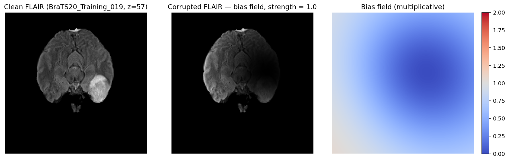
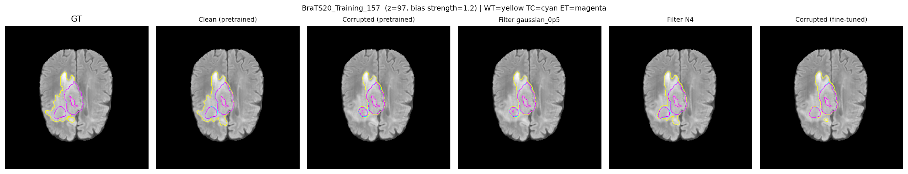

# Brain Tumor Segmentation Robustness

Studying how MRI artifacts affect brain tumor segmentation and how preprocessing
and fine-tuning can reduce their impact.

This project uses a pretrained **MONAI SegResNet** with **BraTS2020** MRI scans.
It compares two types of corruption applied to the FLAIR modality: additive Gaussian
noise and smooth multiplicative bias fields. The other three MRI modalities remain unchanged.

Developed for **Computer-Aided Medical Procedures II (IN2022)** at the
**Technical University of Munich**, Summer Semester 2026.

## Brain MRI Examples

### Intensity distortion



**Left:** clean FLAIR scan. **Middle:** the same slice with synthetic bias-field corruption.
**Right:** the smooth intensity field applied to the image.

### Tumor segmentation



The panels compare ground truth, clean pretrained prediction, corrupted pretrained
prediction, Gaussian filtering, N4 correction, and corruption-aware fine-tuning.
**Yellow:** whole tumor (WT). **Cyan:** tumor core (TC). **Magenta:** enhancing tumor (ET).

*Both figures come from the original course presentation and report. They illustrate
the original experiments, rather than outputs from the revised code.*

## Approach

| Component | Description |
|---|---|
| Dataset | BraTS2020, with T1, T1ce, T2, FLAIR, and segmentation labels |
| Model | Pretrained MONAI SegResNet, bundle version 0.5.3 |
| Corruptions | Gaussian noise and multiplicative bias fields, applied only to FLAIR |
| Preprocessing | Mean and Gaussian smoothing; N4 correction for bias fields |
| Fine-tuning | A separate corruption-augmented model for each artifact type |
| Evaluation | WT, TC, and ET Dice; HD95; sensitivity; false-positive and false-negative volumes |

Patients are split into **70% training, 15% validation, and 15% testing** using a fixed seed.
Corruption severity and smoothing filters are selected on a validation subset; checkpoints
are selected using the full validation set. The test set is used for final evaluation.
Fine-tuned models are also evaluated on clean scans to measure changes in clean performance.

The revised pipeline uses positive bias fields, preserves the clean brain support during
filtering, and trains overlapping tumor regions with sigmoid Dice plus binary cross-entropy.
Paired comparisons include bootstrap confidence intervals and Holm-adjusted Wilcoxon tests.
For HD95, an empty prediction or reference alone receives a volume-diagonal penalty;
this is a project convention.

## Getting Started

### 1. Install dependencies

Use **Python 3.10** for the pinned environment. A CUDA-capable GPU is recommended for
full experiments; the original project used a GPU with 24 GB of memory.

Run these commands from the repository root:

```bash
python -m venv .venv
source .venv/bin/activate
python -m pip install --upgrade pip
python -m pip install torch==2.3.1 --index-url https://download.pytorch.org/whl/cu121
python -m pip install -r requirements.txt
```

On Windows PowerShell, activate the environment with `.venv\Scripts\Activate.ps1`.

### 2. Prepare the dataset

Obtain the data through the [BraTS2020 challenge page](https://www.med.upenn.edu/cbica/brats2020/)
and follow its access terms. Set the data path to the folder directly containing the patient folders:

```bash
export BRATS_DATA_ROOT=/path/to/MICCAI_BraTS2020_TrainingData
```

On Windows PowerShell:

```powershell
$env:BRATS_DATA_ROOT = "C:\path\to\MICCAI_BraTS2020_TrainingData"
```

Each patient folder must contain `{patient_id}_flair`, `_t1`, `_t1ce`, `_t2`, and `_seg`
files in `.nii` or `.nii.gz` format. Use the standard co-registered, skull-stripped
BraTS2020 images with 1 mm isotropic spacing and segmentation labels `{0, 1, 2, 4}`.
The pretrained model is downloaded automatically when Study 1 runs.

### 3. Run the notebook

```bash
jupyter lab notebooks/robustness_experiments.ipynb
```

Start with a fresh kernel and run all cells in order:

1. **Study 1 - Gaussian noise:** creates the patient split and runs the noise experiments.
2. **Study 2 - Bias fields:** reuses the same split and runs the bias-field experiments.

Predictions, checkpoints, metrics, and figures are saved under:

```text
outputs/brats_robustness_v3/
outputs/brats_robustness_bias_v3/
```

Generated outputs, datasets, and downloaded model weights are excluded from Git.
When changing experiment settings, code, or data, use a fresh output directory.
Custom paths can be configured using `BRATS_OUT_ROOT`, `BRATS_OUT_ROOT_BIAS`,
`BRATS_GAUSSIAN_OUT_ROOT`, and `BRATS_BUNDLE_DIR`. If the Gaussian output path changes,
set `BRATS_GAUSSIAN_OUT_ROOT` to the same path for Study 2.

## Repository Contents

| Path | Purpose |
|---|---|
| `brats_robustness/` | Shared Python code for data, corruption, inference, training loss, and evaluation |
| `notebooks/robustness_experiments.ipynb` | Both experiment workflows |
| `figures/` | Original MRI and segmentation examples used in this README |
| `docs/historical/` | Original course report and presentation |
| `requirements.txt` | Experiment dependencies |
| `.gitignore` | Exclusions for data, model weights, and generated files |

## Report and Project Status

- [Project report](docs/historical/Robustness_of_Brain_Tumor_Segmentation_under_MRI_Corruptions_report.pdf)
- [Presentation slides](docs/historical/brats_robustness_bias_slides.pptx)

The report and slides document the original course experiments. The code has since
been revised, and the full experiments have **not yet been rerun**. Original figures
and numerical results should therefore not be presented as validation of the revised pipeline.

This study uses synthetic artifacts, one model architecture, and one local patient split.
The test patients are held out from local fine-tuning, but overlap with the pretrained
model's training data has not been verified. Clinical and cross-corruption generalization
have not been established.

## Team

Implemented collaboratively by a team of three students as part of
Computer-Aided Medical Procedures II (IN2022) at the Technical University of Munich,
Summer Semester 2026.

Built with [MONAI](https://monai.io/), [BraTS](https://www.med.upenn.edu/cbica/brats2020/),
and [SimpleITK](https://simpleitk.org/).
